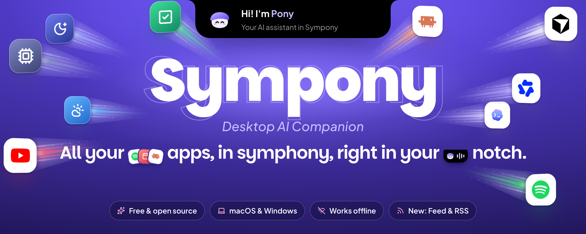
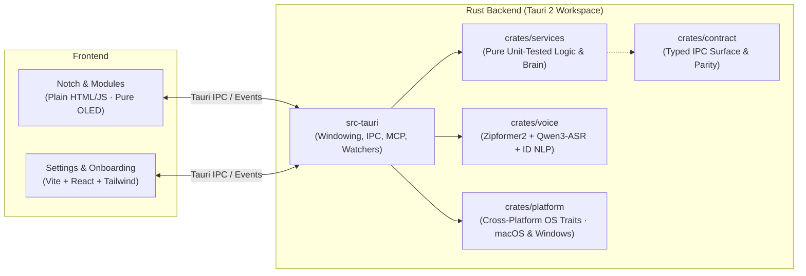
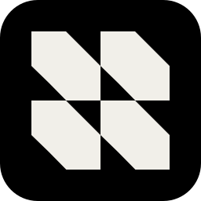

<div align="center">



<br />

# Sympony

**Your desktop notch AI companion — local-first Pony assistant (MCP, Skills, Eyes & Hands), offline Indonesian-first voice dictation, and 24 OLED modules in Rust.**

<p>
  <a href="https://sympony.enlabs.my.id"></a>
  <a href="https://github.com/rheynoapria/sympony-ai/releases"></a>
  <a href="https://github.com/rheynoapria/sympony-ai/actions/workflows/ci.yml"></a>
  
  
  
  
  <a href="LICENSE"></a>
</p>

<p>
  <a href="#-meet-pony--your-notch-ai-companion">Meet Pony</a> •
  <a href="#-voice-v1--on-device-indonesian-first-dictation">Offline Voice</a> •
  <a href="#-24-oled-notch-modules">Notch Modules</a> •
  <a href="#-platform-support">Platforms</a> •
  <a href="#-security--privacy-by-design">Security</a> •
  <a href="#-getting-started">Build from Source</a>
</p>

</div>

---

## Why Sympony?

Most desktop notch utilities stop at media controls or file shelves. **Sympony** turns the top of your screen into a pure OLED (`#000`) command center powered by a native Rust + Tauri 2 backend — combining a **local-first AI companion (Pony)**, **on-device speech-to-text**, **YouTube video mode**, and **24 everyday productivity modules** in one lightweight desktop app.

> **Open Source & 100% Self-Contained**
> This open-source repository ships with **no hardcoded cloud AI backend or hosted Sympony AI connection**. Pony connects directly to **your own local CLI agents** (Claude Code, Codex, Gemini CLI, etc.) or **any OpenAI-compatible server you control** (Ollama, LM Studio, or your own gateway). Any hosted Sympony AI endpoint exists solely in official Enlabs release bundles and is never embedded in source builds.

---

## ✨ Meet Pony — Your Notch AI Companion

**Pony** lives right inside your desktop notch — or detached in a resizable **Floating Pony Chat** companion window — with expressive moods, streaming answers, collapsible thinking timelines, and mid-run steering, without vendor lock-in.

<table>
<tr>
<td width="50%" valign="top">

### 🧠 Bring Your Own Brain
- **Any OpenAI-Compatible Server** — Point Pony (and Translate) at Ollama, LM Studio, or your own OpenAI-compatible API server with full SSE streaming, automatic retries, and prompt-cache-friendly turn layout.
- **Local Coding CLIs** — Drive Claude Code, Codex, Gemini CLI, Qwen Code, OpenCode, Antigravity, Hermes, or Paseo directly from the notch.
- **Floating Pony Chat & Live Steering** — Detach chat into an always-on-top floating window (`macOS` & `Windows`) with shared live history, steer Pony mid-run without cancelling work, or stop cleanly mid-stream.

</td>
<td width="50%" valign="top">

### 🧩 Skills, Memory & MCP Tools
- **Agent Skills (`agentskills.io`)** — Standard `SKILL.md` folders in `~/.sympony/skills/` with built-in routines (`plan-my-day`, `wrap-up`, `focus-session`), inline editor, and zip import/export.
- **Transparent Memory** — Readable, editable facts in `~/.sympony/memory.json` plus semantic `recall` across past conversations.
- **External MCP Servers** — Connect **stdio** and **Streamable HTTP** MCP servers, plus sandboxed **QuickJS Code Mode** for large toolkits.

</td>
</tr>
<tr>
<td width="50%" valign="top">

### 👁️ Eyes & Hands *(Opt-in)*
- **Screen Reading (`screen_read`)** — Inspects the active window through native Accessibility APIs (including Chromium/Electron) with on-device OCR fallback for unlabeled UIs.
- **Checked UI Automation (`screen_do`)** — Accessibility-first actions with a live aurora edge glow, Pony cursor overlay, and **Routine Replay** that learns and replays multi-step workflows.
- **Ask Other AIs (`ask_ai`)** — Delegate prompts to Claude, ChatGPT, or Gemini in your browser or desktop app and receive answers straight in your notch without losing focus.

</td>
<td width="50%" valign="top">

### 🪪 Human-in-the-Loop Notch Cards
- **Coding Agent Hooks** — Answer agent questions and approve tool permissions from Claude Code or Paseo directly from the closed notch.
- **Scoped Commands & Files *(Opt-in)*** — Approval cards for shell/file actions with conservative read-only auto-run and strict secret protection.
- **Scheduled Briefs** — Automated morning/evening summaries delivered quietly to your notch.

</td>
</tr>
</table>

---

## 🎙️ Voice V1 — On-Device Indonesian-First Dictation

Fast, private dictation engineered for **Indonesian & Indonesian–English code-switching**, running 100% locally on-device:

- **Hybrid Dual-Engine Pipeline**
  - **Live Partials:** `Zipformer2-id` int8 streaming (`sherpa-onnx`) for instant real-time captions in the notch pill.
  - **Accurate Final Pass:** `Qwen3-ASR-0.6B` (or optional `1.7B` on ≥16 GB machines) accelerated via **Metal** on Apple Silicon (`transcribe-cpp`), with CPU fallback.
- **Deterministic Indonesian Post-Processing** — Phonetic vocabulary correction guarded by Indonesian (`hunspell-id`) & English (`SCOWL`) dictionaries, KBBI spelling normalization, spoken punctuation, dates/units/emails, `di-` prefix joining, and your own custom dictionary (`~/.sympony/dictionary.json`).
- **One Key, Two Modes** — Hold your dictation key while focused in any text field to dictate directly (preserving your clipboard cleanly); press it anywhere else to speak straight to **Pony** with active window context attached.

---

## 🎛️ 24 OLED Notch Modules

Swipe, scroll, or pick from the floating menu notch to switch across modular widgets — styled in pure OLED Black (`#000`), Liquid Smoked Crystal **Glass**, or custom **Color** themes with 18 module layout presets:

| Category | Modules |
|---|---|
| **AI & Voice** | **Pony Assistant** (notch & floating chat, skills, memory, briefs) • **Translate** (multi-provider LLM translation) • **AI Usage** (Claude & Codex plan limits) • **Voice Dictation Pill** |
| **Media & Focus** | **Home** (Now Playing, album-art ambient waves, **YouTube Video Mode & Floating PiP**, mirror) • **Pomodoro** (focus timer, stopwatch, ambient sounds) • **Teleprompter** (camera-aligned scrolling script) • **Radio** (Radio Browser streams) |
| **Tasks & Time** | **Calendar** (monthly events & tasks) • **Todo** (tasks with trash/restore & optional Google Tasks sync) • **Notes** (quick scratchpad) • **World Clock** (meeting planner) • **Day Progress** • **Prayer Times** (countdown & adhan) |
| **System & Dev** | **Shelf** (drag-and-drop file tray) • **Control** (volume, audio I/O, brightness, Wi-Fi, Bluetooth, Focus, Color Picker) • **System** (CPU, RAM, disk, network) • **GitHub** (PR review queue) • **Bluetooth / Speed Test** (Cloudflare) • **Notifications** • **Launcher** • **Bookmarks** • **Weather** (Open-Meteo) • **Health & Screen Time** |

---

## 🌍 Platform Support

Sympony is designed from day one as a **multi-platform desktop notch** using clean OS abstraction traits (`crates/platform`) and a shared pure-Rust service layer (`crates/services`):

| Platform | Status | Backend & Packaging |
|---|---|---|
| **macOS** *(11.0+, Apple Silicon)* | ✅ **Stable & Beta** | Native `objc2` FFI, Accessibility, CoreAudio, Apple Vision OCR, Metal STT, Developer ID Signed & Notarized `.dmg` + In-App Auto-Updater (`darwin-aarch64`) |
| **Windows** *(Windows 10/11, x64)* | 🧪 **Beta Ready** | Native Win32/WinRT notch, per-monitor DPI, GSMTC media + YouTube video/PiP, Core Audio, WMI brightness, Wi-Fi (`wlanapi`), Bluetooth audio, Color Picker, Floating Pony Chat, NSIS `.exe` installer + In-App Auto-Updater (`windows-x86_64`) |
| **Linux** *(Wayland / X11)* | 🚧 **Planned** | Shared `crates/services` & `crates/voice` ready; implementing `crates/platform` Linux backend + `.deb` / `.rpm` / `.AppImage` |

Contributions toward the **Windows** (UI Automation Eyes/Hands) and **Linux** `crates/platform` backends are very welcome!

---

## 🛡️ Security & Privacy by Design

Sympony interacts with powerful OS capabilities only when you explicitly opt in, backed by defense-in-depth safeguards (see [SECURITY.md](SECURITY.md)):

- **Opt-In High-Privilege Features** — Shell/File tools (`ponyExec`), Screen Reading (`ponyEyes`), UI Automation (`ponyHands`), Ask AI (`ponyAskAi`), and external MCP servers are **disabled by default** and automatically **disarmed on backup import**.
- **Per-Turn Taint Tracking** — Reading untrusted external content (web pages, screen contents, external AI responses, or outside MCP results) taints the current turn so every command, file tool, memory write, and skill edit requires explicit confirmation on a card — **even in YOLO mode**.
- **Credential & Config Protection** — Home-anchored AI CLI credentials, `.ssh`, `.aws`, `.gnupg`, Keychains, shell startup profiles, LaunchAgents, and Sympony's own secrets are guarded across symlink resolution, `..` normalization, and compound `cd` commands.
- **Privacy Guards for Eyes & Voice** — Password managers, 2FA authenticators, secure password fields, and OS Secure Input are strictly excluded from screen reading and clipboard pasting; OCR snapshots use private auto-deleted temp files.
- **Hardened Runtime & Scoped Permissions** — Minimal OS entitlements, `0600` data files / `0700` directories, scrubbed stdio MCP environments, constant-time token verification + CSRF headers on the local phone bridge, and SSRF-checked HTTP redirects.

---

## 🏗️ Architecture



| Path | Role |
|---|---|
| `src-tauri/` | Tauri 2 application shell, window management, IPC command/service wiring, MCP host, OS helpers |
| `crates/services/` | Pure, unit-tested business logic (Pony engine, MCP client, QuickJS code mode, security guards, services) |
| `crates/voice/` | Offline Indonesian-first hybrid STT engine, phonetic post-corrector, KBBI normalizer, and eval harness |
| `crates/platform/` | Cross-platform OS traits (`Trigger`, `Capture`, `Insert`, `Secrets`, `Location`, `AX`) and native bindings |
| `crates/contract/` | Frontend–backend IPC contract definition and parity verification (`216/216`) |
| `frontend/` | Lightweight, zero-bundler OLED notch UI, Pony character canvas, and 24 modular tabs |
| `settings-ui/` | Modern React + TypeScript Settings & Onboarding UI (built via Bun into `frontend/settings-dist/`) |

---

## 🚀 Getting Started

### Download & Per-OS In-App Auto-Updates

Download the installer for your OS automatically at **[sympony.enlabs.my.id](https://sympony.enlabs.my.id)** (auto-detects macOS & Windows) or directly from **[GitHub Releases](https://github.com/rheynoapria/sympony-ai/releases)**:

- **macOS (`darwin-aarch64`):** Apple Developer ID signed & notarized `.dmg` installer (Stable & Beta).
- **Windows (`windows-x86_64`):** Signed NSIS `_x64-setup.exe` installer for Windows 10/11 x64 (currently on Beta channel).
- **Dual-Channel Per-OS Auto-Updater:**
  - **Stable channel (`vX.Y.Z`):** Everyday releases built from `main`.
  - **Beta channel (`vX.Y.Z-beta.N`):** Early preview builds cut from `beta`. Opt in anytime via **Settings → About & Updates → Watch Beta updates** — each OS receives independent notifications only when a signed binary for its platform (`darwin-aarch64` or `windows-x86_64`) ships, installs in-place automatically, and graduates Beta users smoothly to Stable when Stable ships.

### Prerequisites

- **Rust** stable toolchain (`rustup`)
- **Bun** (`curl -fsSL https://bun.sh/install | bash`)
- **macOS:** macOS 11.0+ & Xcode Command Line Tools (`xcode-select --install`)
- **Windows:** Windows 10/11 (x64), Visual Studio Build Tools (C++ workload), WebView2 Runtime, Python 3, and Git Bash (for `release/build.sh`)

### Run in Development

```bash
# 1. Clone the repository
git clone https://github.com/rheynoapria/sympony-ai.git
cd sympony-ai

# 2. Install & build the Settings UI
bun install --cwd settings-ui --frozen-lockfile
bun run --cwd settings-ui build

# 3. Launch Sympony in dev mode
cargo tauri dev
```

### Build & Install Locally

```bash
# macOS — Optional (recommended once): create a stable local code-signing identity
# so macOS preserves Accessibility / Mic / Screen Recording permissions across rebuilds
./tools/make-cert.sh

# macOS — Build release .app and install to /Applications/Sympony.app
./install.sh

# macOS (.dmg) or Windows (NSIS .exe, run in Git Bash) — Build installer into release/out/<version>/
./release/build.sh
```

> [!TIP]
> **Optional Setup:**
> - **Google Tasks Sync:** Follow [docs/google-oauth-setup.md](docs/google-oauth-setup.md) to supply your own desktop OAuth credentials in `.signing/oauth.env`.
> - **Local AI Server / Testing:** Point **Settings → Pony → Brain** to Ollama, LM Studio, or any OpenAI-compatible URL — or test locally with `bun tools/mock-ai-router.ts`.

### Running Tests

```bash
cargo test --workspace
cargo run -q -p services --bin parity
bun test --cwd settings-ui
bun test ./frontend/tests
```

---

## 🤝 Contributing & Licensing

- **Contributing:** See [CONTRIBUTING.md](CONTRIBUTING.md) for guidelines, branch targeting (`beta` vs `main`), and the PR verification checklist.
- **Changelog & Releases:** See [CHANGELOG.md](CHANGELOG.md) for version history and [docs/RELEASING.md](docs/RELEASING.md) for our SemVer & dual-channel release standard.
- **Security Policy:** See [SECURITY.md](SECURITY.md) for vulnerability reporting and our local-privilege security model.
- **Third-Party Notices:** See [THIRD_PARTY_NOTICES.md](THIRD_PARTY_NOTICES.md) for dictionary, model, icon, and library attributions.
- **License:** Distributed under the **GNU General Public License v3.0 only (`GPL-3.0-only`)**. See [LICENSE](LICENSE) for details.

---

<div align="center">
  <a href="https://enlabs.my.id">
    
  </a>
  <br />
  <sub><strong>Sympony</strong> is a product of <a href="https://enlabs.my.id"><strong>Enlabs</strong></a> · Copyright © 2026 Enlabs</sub>
</div>
