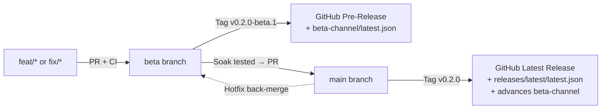

# Versioning, Branching & Release Guide

Sympony follows **[Semantic Versioning 2.0.0](https://semver.org/)**, **[Keep a Changelog](https://keepachangelog.com/en/1.1.0/)**, and **[Conventional Commits](https://www.conventionalcommits.org/)** with a dual-channel (**Stable** + **Beta**) in-app auto-updater.

---

## 1. Branch Strategy

| Branch | Role | Releases Cut From Here | Auto-Updater Channel |
|---|---|---|---|
| **`main`** | **Stable** — production-ready code only | `vX.Y.Z` (e.g. `v0.2.0`, `v0.2.1`) | **Stable** (`releases/latest/download/latest.json`) + graduates **Beta** users |
| **`beta`** | **Beta / Integration** — upcoming features & preview fixes | `vX.Y.Z-beta.N` (e.g. `v0.2.0-beta.1`, `v0.2.0-beta.2`) | **Beta** (`releases/download/beta-channel/latest.json`) |
| **`feat/*`**, **`fix/*`**, **`chore/*`** | Short-lived feature & bugfix branches | Never tagged directly | — |
| **`hotfix/*`** | Urgent Stable bug fixes branched from `main` | Merged to `main` → `vX.Y.(Z+1)`, then merged back into `beta` | **Stable** (won't regress `beta-channel` if a newer Beta exists) |



---

## 2. Versioning Standard (SemVer 2.0.0)

All three version manifests stay in strict lockstep (enforced by CI via `./tools/bump-version.sh --check`):
- [`Cargo.toml`](../Cargo.toml) (`[workspace.package].version`)
- [`src-tauri/tauri.conf.json`](../src-tauri/tauri.conf.json) (`.version`)
- [`settings-ui/package.json`](../settings-ui/package.json) (`.version`)

| Release Type | Version Format | Git Tag | GitHub Release Type |
|---|---|---|---|
| **Beta preview** | `X.Y.Z-beta.N` | `vX.Y.Z-beta.N` | Pre-release (`prerelease: true`) |
| **Release Candidate** | `X.Y.Z-rc.N` | `vX.Y.Z-rc.N` | Pre-release (`prerelease: true`) |
| **Stable** | `X.Y.Z` | `vX.Y.Z` | Latest release (`prerelease: false`) |

### SemVer Progression Rules
- `0.1.0 < 0.2.0-beta.1 < 0.2.0-beta.2 < 0.2.0 < 0.2.1-beta.1 < 0.2.1`
- **Beta builds default to Beta channel:** When `updateBeta` is unset (`null`), a `-beta` build watches Beta automatically; a Stable build watches Stable.
- **No forced downgrades:** Turning **Watch Beta updates** off while running `0.2.0-beta.2` keeps you on `0.2.0-beta.2` until `0.2.0` (Stable) ships, at which point you upgrade smoothly to Stable.
- **Seamless Beta → Stable graduation:** When Stable `v0.2.0` publishes, CI updates `beta-channel/latest.json` as well (provided `0.2.0 >= current beta-channel`), so Beta testers immediately receive the Stable banner (`New Release`) and graduate to Stable.

---

## 3. Conventional Commits

Write commit messages using `type(scope): short summary` so release notes categorize cleanly when `CHANGELOG.md` entries aren't written manually:

| Prefix | Release Notes Category |
|---|---|
| `feat(scope):` | 🚀 Highlights & New Features |
| `fix(scope):` | 🐛 Bug Fixes |
| `perf(scope):` | ⚡ Performance |
| `security(scope):` | 🛡️ Security |
| `refactor(scope):` | ✨ Improvements & Changes |
| `docs:` / `ci:` / `chore:` / `test:` | 🔧 Build, CI & Maintenance |

---

## 4. GitHub Repository & Environment Security Setup

### Environment `Production` (`Settings → Environments → Production`)
Official signing credentials live exclusively in the **`Production`** environment:
- **Apple Code Signing & Notarization:** `APPLE_CERTIFICATE`, `APPLE_CERTIFICATE_PASSWORD`, `APPLE_SIGNING_IDENTITY`, `APPLE_API_KEY`, `APPLE_API_KEY_ID`, `APPLE_API_ISSUER`
- **Hosted Sympony AI (Official builds only):** `SYMPONY_AI_URL`
- **Tauri Auto-Updater Signing:** `TAURI_SIGNING_PRIVATE_KEY`, `TAURI_SIGNING_PRIVATE_KEY_PASSWORD`

Set **Deployment branches and tags** to **`Selected branches and tags`** (never *No restriction*) with ONLY:
1. **Tag pattern:** `v*` *(locked to Repository Admin via the `Protect release tags (v*)` ruleset, so only the repository owner/admin can ever trigger official signing secrets)*

### Recommended GitHub Rulesets (`Settings → Rules → Rulesets`)
- **Branch ruleset (`Protect main & beta`):**
  - Require pull requests + **CODEOWNER approval (`@rheynoapria`)** + dismiss stale reviews on push (with Repository Admin bypass)
  - Require status checks to pass before merging: `Frontend & Hygiene`, `Rust & Contract Parity (macOS)`
  - Block force pushes & branch deletions
- **Tag ruleset (`Protect release tags (v*)`):**
  - Restrict tag creation, updates, and deletion to repository admins so published release tags are immutable.

---

## 5. Cutting a Release

### A. Publishing a Beta Release (from `beta`)
```bash
git checkout beta && git pull origin beta

# 1. Bump to next Beta (e.g. 0.1.0 -> 0.2.0-beta.1, or 0.2.0-beta.1 -> 0.2.0-beta.2)
./tools/bump-version.sh beta

# 2. Review & polish highlights in CHANGELOG.md, then run full local checks
./tools/bump-version.sh --check
bun --cwd settings-ui test && bun test ./frontend/tests && cargo test --workspace

# 3. Commit, annotate tag, and push
git add Cargo.toml Cargo.lock src-tauri/tauri.conf.json settings-ui/package.json CHANGELOG.md
git commit -m "chore(release): prepare v0.2.0-beta.1"
git tag -a v0.2.0-beta.1 -m "Sympony v0.2.0-beta.1"
git push origin beta --follow-tags
```

### B. Graduating Beta to Stable (on `main`)
```bash
# 1. Merge soak-tested `beta` into `main`
git checkout main && git pull origin main
git merge --no-ff beta

# 2. Promote 0.2.0-beta.N -> 0.2.0
./tools/bump-version.sh graduate

# 3. Consolidate release highlights in CHANGELOG.md, commit, tag & push
git add Cargo.toml Cargo.lock src-tauri/tauri.conf.json settings-ui/package.json CHANGELOG.md
git commit -m "chore(release): release v0.2.0"
git tag -a v0.2.0 -m "Sympony v0.2.0"
git push origin main --follow-tags

# 4. Sync main back into beta so beta starts clean for the next cycle
git checkout beta && git merge main && git push origin beta
```

### C. What Happens Automatically in GitHub Actions
1. **`validate` job:** Checks SemVer tag syntax, verifies `Cargo.toml` / `tauri.conf.json` / `settings-ui/package.json` match the tag version, and fails fast before spending macOS runner time.
2. **`build` job (`Production` environment):** Builds Settings UI + Rust release binary, signs `Sympony.app` with Apple Developer ID, creates & signs `.dmg`, notarizes & staples both `.dmg` and `Sympony.app`, packs `Sympony_<ver>_<arch>.app.tar.gz`, signs it with `cargo tauri signer sign --app-version <ver>`, and computes `SHA256SUMS.txt`.
3. **`publish` job:** Generates structured release notes via `tools/release-notes.py` (from `CHANGELOG.md` + commit history + download table), builds `latest.json`, publishes the versioned GitHub Release (`Sympony vX.Y.Z` or `Sympony vX.Y.Z-beta.N (Beta)`), and updates the floating `beta-channel` prerelease pointer whenever the release is `>=` the existing `beta-channel` version.
